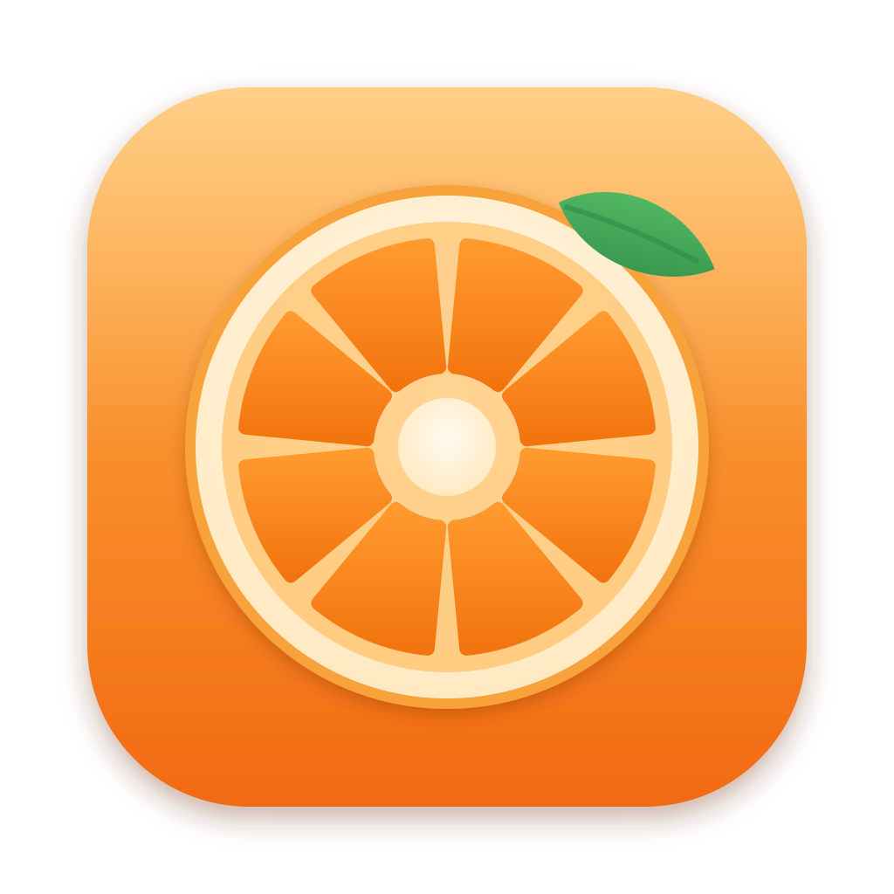
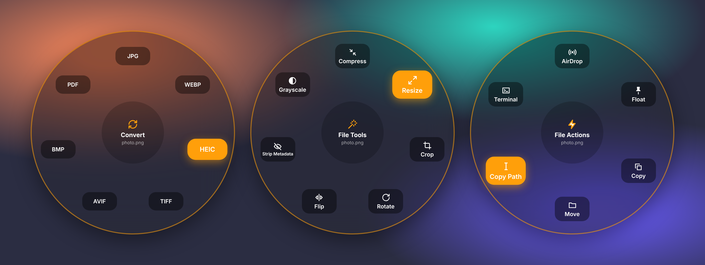
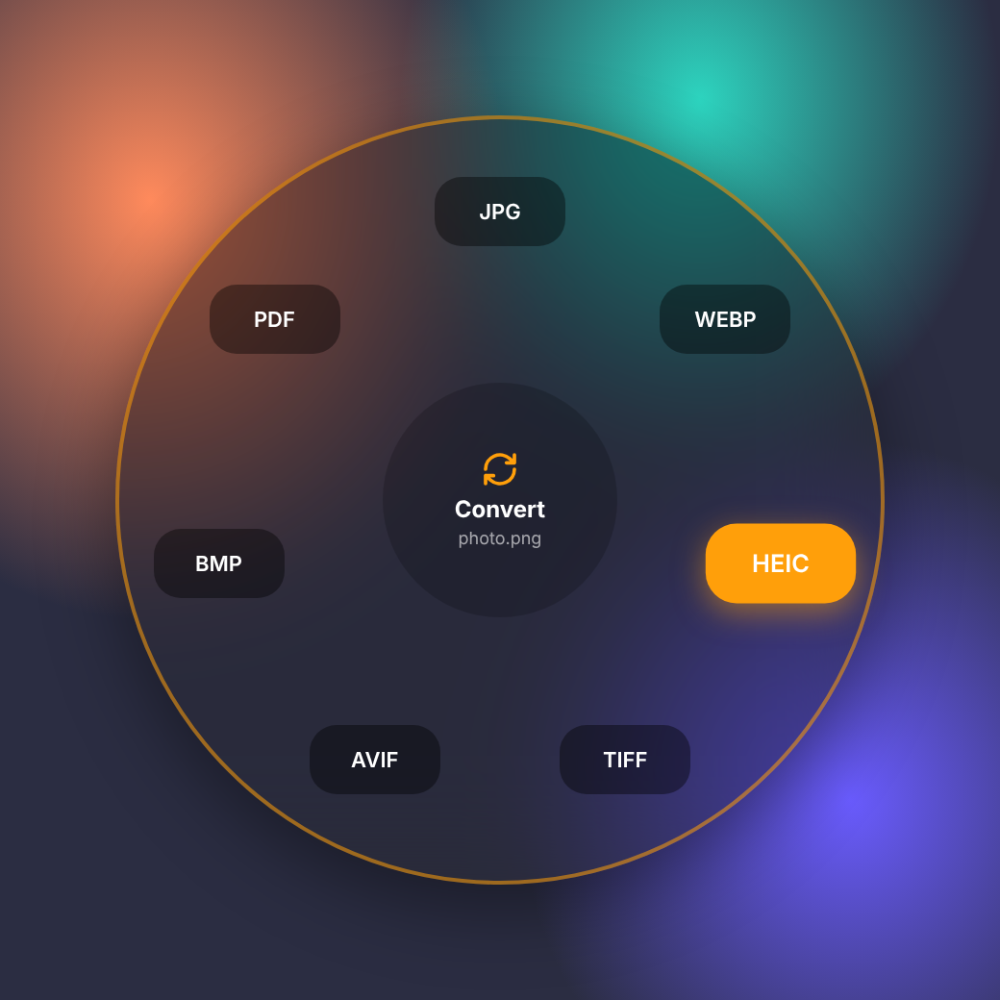
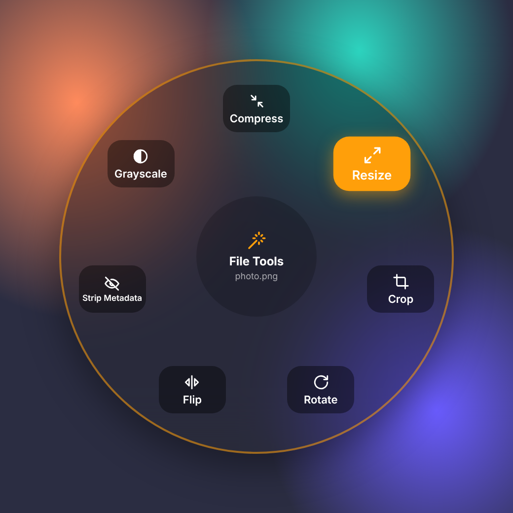
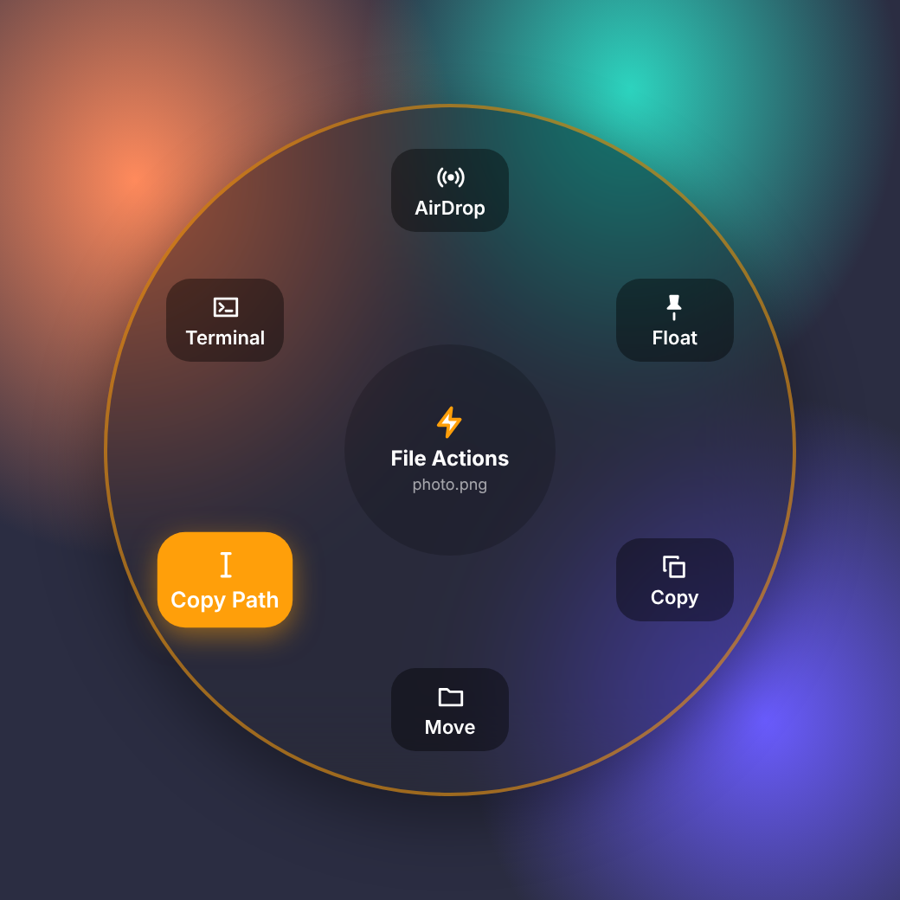

<p align="center">
  
</p>

<h1 align="center">Satsuma</h1>

<p align="center">
  <b>Drag a file. Tap a key. Drop it on the wheel. Done.</b><br>
  A free, open-source, offline file converter and toolbox that lives in your Mac's menu bar.
</p>

<p align="center">
  
</p>

> The images above and below are renderings of the wheel layout, drawn to match the app's geometry and colors.
> Replace them with real screenshots whenever you like (see [Contributing](#contributing)).

---

## Why Satsuma?

Converting a HEIC photo, trimming a clip, merging PDFs, turning a Markdown note into a Word document... normally that
means a different app, website or command-line tool for each job. Satsuma puts all of it behind one gesture, in the place
you are already working (Finder, your desktop, a download folder), and it never uploads anything.

- **One gesture for everything.** Drag any file, *tap* a modifier key, keep dragging, and drop it on a wheel segment.
- **Offline and private.** Files are converted on your Mac. Converter processes are network-isolated where macOS allows it.
- **Free and open source.** No account, no subscription, no ads, no telemetry.
- **Native where possible.** Images, PDFs, OCR, documents, EPUB, subtitles and archives use macOS's own frameworks.
  Heavier jobs (audio/video, Office formats) use the best open-source engines if you have them installed.

## Contents

- [How it works](#how-it-works) · [The three wheels](#the-three-wheels) · [Supported conversions](#supported-conversions)
- [File tools](#file-tools) · [File actions](#file-actions) · [Other ways to start](#other-ways-to-start)
- [Install](#install) · [Permissions](#permissions) · [Settings](#settings) · [Conversion engines](#conversion-engines)
- [Security and privacy](#security-and-privacy) · [Troubleshooting](#troubleshooting) · [Known limits](#known-limits)
- [Project layout](#project-layout) · [Contributing](#contributing) · [License](#license)

## How it works

1. **Drag** one or more files (or folders) from Finder or anywhere else.
2. **Tap** a wheel key (Shift, Command or Control by default). Tap it, don't hold it.
3. **Keep dragging** onto a segment of the wheel that appeared under your cursor, then **drop**.

The wheel stays open until you drop or press **Esc**. You can also steer it with the keyboard:

| Key | Action |
|---|---|
| ← ↑ / → ↓ | Move the highlight around the wheel |
| Return | Apply the highlighted item |
| Esc | Close the wheel |
| Tap another wheel key | Switch to that wheel |

Results appear next to the original (or in a folder you choose). A small floating HUD shows progress and tells you
when a job finished, partly succeeded, or failed. Jobs run one at a time, so queueing a lot of files is safe.

## The three wheels

| Tap while dragging | Wheel | What it does |
|---|---|---|
| ⇧ Shift (default) | **Convert** | Lists every format the selected file can become |
| ⌘ Command (default) | **File Tools** | Compress, resize, crop, trim, split, merge and more |
| ⌃ Control (default) | **File Actions** | AirDrop, Float, Copy, Move, Copy Path, Terminal |

### Convert
<p align="center"></p>

The wheel adapts to the file you drag. Here, a PNG offers JPG, WEBP, HEIC, TIFF, AVIF, BMP and PDF. Drag several files
of the same kind and the wheel shows only the formats they all share.

### File Tools
<p align="center"></p>

Only the tools that make sense for the selection appear: an image gets Compress, Resize, Crop and so on; a video
gets Trim, Mute and Speed. Tools that need a number (a size, a time range, pages) ask with a small prompt first.

### File Actions
<p align="center"></p>

Actions work on any file, folder or mixed selection.

## Supported conversions

More than 250 input → output pairs. Targets never include the file's own format.

| You drag | You can convert to |
|---|---|
| **Images** · JPG, PNG, WEBP, HEIC, TIFF, AVIF, BMP, SVG | JPG, PNG, WEBP, HEIC, TIFF, AVIF, BMP, PDF |
| **Video** · MP4, MOV, MKV, WEBM, AVI, WMV, GIF | MP4, MOV, MKV, WEBM, AVI, WMV, GIF, MP3 (audio only) |
| **Audio** · MP3, M4A, WAV, FLAC, OGG, OPUS, AIFF, WMA | MP3, M4A, WAV, FLAC, OGG, OPUS, AIFF, WMA |
| **PDF** | DOCX, Pages, PPTX, XLSX, JPG, PNG, EPUB, TXT, Markdown (scanned PDFs are read with on-device OCR) |
| **Documents** · DOCX, DOC, Pages, Markdown, TXT, RTF, RTFD, HTML, ODT, text clippings | DOCX, Pages, Markdown, TXT, EPUB, HTML, PDF |
| **Slides** · PPT, PPTX | PDF, JPG, PNG |
| **Spreadsheets** · XLSX, XLS, ODS, CSV, TSV | XLSX, ODS, CSV, TSV, PDF |
| **EPUB** | DOCX, Markdown, TXT, PDF |
| **Subtitles** · SRT, VTT | SRT, VTT, TXT |
| **Archives** · ZIP, TAR, GZIP (.tar.gz), RAR (read-only) | ZIP, TAR, GZIP |

A few details:

- Image quality for JPEG/HEIC/WebP is adjustable in Settings. Multi-page PDFs export one image per page.
- PDF page images are rendered with a pixel cap so a huge page can't exhaust memory; oversized pages render at a lower DPI.
- Converting an archive extracts it in a temporary folder and re-packs it, with size and symlink protections.
- HTML, Markdown and EPUB are converted by Satsuma's own offline reader. Images and remote content are not fetched and are
  dropped from the output (see [Known limits](#known-limits)).

## File tools

| Works on | Tools |
|---|---|
| **Images** | Compress · Resize (one side keeps the aspect ratio, or give both) · Crop (to an aspect ratio, e.g. 1:1, 4:3, 16:9) · Rotate · Flip · Strip Metadata · Grayscale · Merge → PDF |
| **Video** | Compress · Trim (seconds or mm:ss) · Crop · Mute · Speed 2× · Speed ½× · Merge |
| **Audio** | Trim · Normalize · Compress · Fade In/Out · Merge |
| **PDF** | Compress · Split Pages · Extract Pages (`1-3,5,8-`) · Rotate · Merge |
| **Anything** | Zip (one or many files, folders included) |

*Merge* tools appear when you drag two or more files of the same kind.

## File actions

| Action | What it does |
|---|---|
| **AirDrop** | Opens the AirDrop sharing sheet for the selection |
| **Float** | Pins a small always-on-top thumbnail of the file you can drag out again, handy as a clipboard for files |
| **Copy** | Copies the files to a folder you pick (remembers the last one) |
| **Move** | Moves the files to a folder you pick |
| **Copy Path** | Puts the file path on the clipboard, shell-escaped when the name has unusual characters (configurable) |
| **Terminal** | Opens your terminal app in the file's folder (Terminal by default; any app by bundle ID) |

## Other ways to start

You don't have to drag. From the menu-bar icon:

- **Choose Files…** opens a file picker, then shows the wheel.
- **Use Finder Selection** uses whatever is selected in Finder.
- **⌃⌥↩ (Control + Option + Return)** with Finder in front does the same, from the keyboard.
- Click a segment, or use the arrow keys and Return, when the wheel was opened without a drag.

## Install

Satsuma is built from source (there is no signed, notarized download yet).

**Requirements:** a Mac, Xcode or the Xcode Command Line Tools (`xcode-select --install`), and macOS 13 or later to
build and run. Satsuma is developed and tested on **macOS 26.5 and later**.

```bash
git clone https://github.com/Liam0nster/Satsuma-App.git
cd Satsuma-App
chmod +x Scripts/build_app.sh     # allow the script to run as a program
./Scripts/build_app.sh            # build, assemble the app bundle, and sign it -> build/Satsuma.app
open build/Satsuma.app
```

Drag `build/Satsuma.app` into `/Applications` if you want to keep it. Satsuma has no Dock icon; look for it in the menu bar.

What the build script does: `swift build -c release` compiles an optimized binary, the script copies it into an app bundle
with the icon and `Info.plist`, then signs it with the *hardened runtime* (blocks library injection and unsigned code).

**Keep your permissions across rebuilds.** With the default ad-hoc signature, macOS forgets the privacy grants every
time you rebuild. Use a stable certificate instead: `security find-identity -v -p codesigning` lists yours, or create a
free self-signed one in *Keychain Access → Certificate Assistant → Create a Certificate* (type "Code Signing"), then:

```bash
SIGN_ID="My Cert Name" ./Scripts/build_app.sh
```

If macOS blocks a build that *someone else* gave you and you trust it, remove the download flag with
`xattr -dr com.apple.quarantine build/Satsuma.app` (`-d` deletes an attribute, `-r` applies it recursively). A build
you compiled yourself doesn't need this, and you shouldn't do it to software from an unknown source.

## Permissions

Grant these in **System Settings → Privacy & Security**, then relaunch Satsuma. The Settings window has shortcut buttons.

| Permission | Needed? | Why |
|---|---|---|
| **Input Monitoring** | Required | Sees taps of modifier keys (⇧ ⌘ ⌃ ⌥) while another app is in front. Satsuma does **not** read ordinary key presses. |
| **Accessibility** | Optional | Lets the wheel *consume* its own keys so Return/arrows never reach the app underneath, and lets Return cancel an in-flight drag. Without it, click-opened wheels are mouse-only, and drag-opened wheels still take keys (they also reach the other app, but an invisible drop-catcher stops a stray drop). |
| **Automation (Finder, Pages)** | When used | "Use Finder Selection" and `.pages` conversions. |

## Settings

Open Settings from the menu-bar icon.

- **Wheel keys.** Choose which modifier opens which wheel. Each wheel needs its own key.
- **Output.** Save next to the original or into a folder you choose; reveal results in Finder; optionally move originals
  to the Trash after a *verified* successful conversion; image quality slider; Copy Path format.
- **Safety limits.** Per-job time limit (default 60 min) and archive-extraction size limit (default 20 GB).
- **General.** Launch at login, terminal app bundle ID, and shortcuts to the privacy panes.
- **Conversion engines.** A live check of which optional engines were found, and whether network isolation is active.

## Conversion engines

Built in (always available): images (ImageIO), PDF text/images/OCR (PDFKit + Vision), documents (AppKit),
Markdown, EPUB build/read, subtitles, CSV↔TSV, archives (`ditto`, `zip`, `tar`).

Optional engines (not bundled by default). Install what you need:

| Needed for | Engine | Install |
|---|---|---|
| Audio and video, WebP/AVIF fallback, all audio/video tools | ffmpeg + ffprobe | `brew install ffmpeg` |
| PPT/PPTX, XLS/XLSX/ODS, PDF → DOCX/PPTX/XLSX | LibreOffice | `brew install --cask libreoffice` |
| `.pages` import and export | Apple Pages | Mac App Store |
| Better PDF compression | Ghostscript | `brew install ghostscript` |

To bundle tools inside the app: `FFMPEG=$(which ffmpeg) FFPROBE=$(which ffprobe) ./Scripts/build_app.sh`.
Homebrew's ffmpeg links to Homebrew libraries, so a copied binary only works on Macs that have them (the script warns
you). Use a statically linked build to be truly self-contained. External tools are only used if they are owned by root
or you and are not group- or world-writable.

## Security and privacy

Satsuma opens files from many sources, so it is built defensively. Nothing is uploaded and there is no telemetry.

- **Network isolation.** ffmpeg, LibreOffice, Ghostscript, `tar` and Quick Look run under `sandbox-exec` with outbound IP
  networking denied and `~/.ssh`, `~/.aws`, `~/.gnupg` and `~/Library/Keychains` unreadable. Settings shows whether it is active.
- **No remote content.** HTML, Markdown and EPUB are read by Satsuma's own offline reader (no WebKit import), so remote
  images, styles and scripts are never fetched. LibreOffice runs with macros and linked-content updates off.
- **Symlink and path safety.** Archives are created with symlinks stored as links (never followed); extracted EPUBs have
  every symlink removed and files are read only if they resolve inside the extraction folder.
- **Quarantine propagation.** Outputs inherit a source's "downloaded from the internet" flag, so Gatekeeper still checks
  them.
- **Limits.** Archive-extraction size cap, image and PDF-page pixel caps, page-range clamping and per-job time limits.
- **Safe defaults.** Originals are trashed only after a verified success; jobs run one at a time; ffmpeg never
  overwrites; failed jobs delete their partial output.

What is **not** protected: file parsers (ImageIO, PDFKit, AppKit's document readers, ffmpeg, LibreOffice, Pages) still
run with your user rights. The sandbox limits what a parser bug can reach, but it is not a full sandbox, so treat files
from strangers like any other untrusted download. `sandbox-exec` is deprecated by Apple (still shipped with macOS); if it
is unavailable the converters still run, just not isolated.

Found a security problem? Please open a private security advisory on GitHub rather than a public issue.

## Troubleshooting

- **Nothing happens when I tap a key.** Check Input Monitoring is on for Satsuma, then quit and relaunch it. With ad-hoc
  signing, rebuilding resets the permission; use `SIGN_ID` (see [Install](#install)).
- **The wheel opens but keys leak into Finder.** Grant Accessibility access.
- **Audio/video items are missing or fail.** Install ffmpeg (Settings → Conversion engines shows what was found).
- **Office formats fail.** Install LibreOffice; `.pages` needs Apple Pages installed.
- **Two wheels open on the same key.** Give each wheel its own modifier in Settings.
- **Where did my result go?** Next to the original, or the folder chosen in Settings. Turn on *Reveal results in Finder*.

## Known limits

- PDF → DOCX/PPTX layout fidelity is whatever LibreOffice produces; PDF → XLSX is a text-column heuristic.
- HTML/Markdown/EPUB → DOCX/PDF drops images (by design, for safety) and renders tables as tab-separated text.
- `.textClipping` input is best-effort. RAR is read-only. Multi-file video merge needs every clip to have an audio track.
- Output names are chosen by checking the folder, then writing (no atomic reservation); another process racing in the
  same folder could interfere.

## Project layout

```
Package.swift                 Swift package (macOS 13+)
Resources/                    Info.plist, entitlements, app icon (SVG, iconset, .icns)
Scripts/build_app.sh          Build, bundle, icon and sign
Sources/Satsuma/
  main.swift, AppDelegate.swift   Menu-bar app and status item
  DragMonitor.swift               Detects drags and modifier taps; Finder selection
  Wheel.swift                     Wheel model, geometry, SwiftUI view, drop target
  Formats.swift                   File categories and conversion targets
  Convert.swift, DocConv.swift    Converters (images, media, PDF, documents, archives, Office)
  HTMLText.swift                  Offline HTML → attributed text
  Tools.swift                     File tools
  FileActions.swift               File actions, job runner, progress HUD
  Security.swift, Util.swift      Sandbox, limits, key capture, helpers
  Settings.swift                  Settings model and window
docs/images/                      README images
```

## Contributing

Issues and pull requests are welcome. Good first contributions: real screenshots for this README, new formats
(add them in `Formats.swift` and the converters), more file tools (`Tools.swift`), and tests.

- Build with `./Scripts/build_app.sh` and test on your macOS version; please mention it in the PR.
- Keep new converters offline and add them to the security notes if they spawn external processes.
- The wheel images in `docs/images/` are rendered mock-ups; to replace them, open a wheel, press **⌘⇧4** then **Space**
  and click the wheel window (or crop a full-screen capture), and save over the matching file.

## License

Released under the [MIT License](LICENSE).
